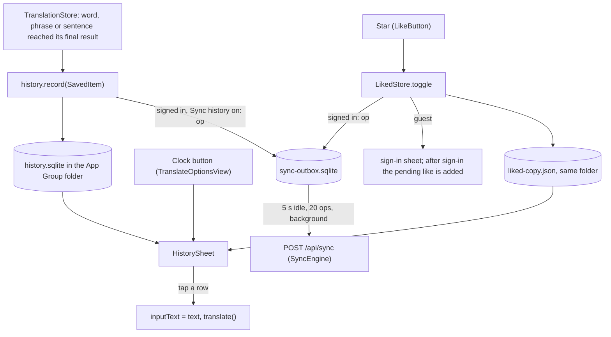
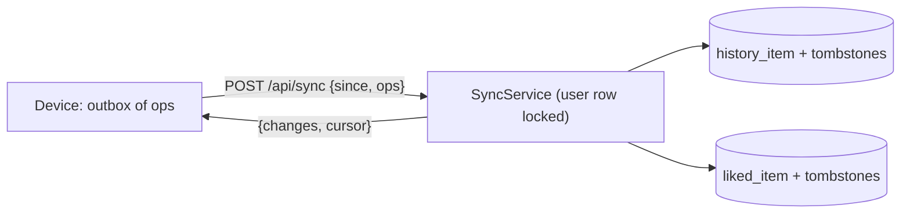
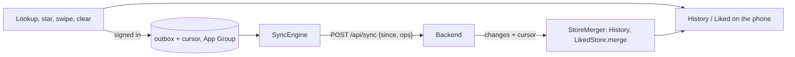

# History and Liked

> Status: **built** (TASK-93.2 iOS lists, TASK-93.1 and 93.3 backend, TASK-93.4 iOS sync). Tested on the iPhone 16 Pro, iOS 18.5 simulator. Last traced from code: 2026-11-04 (TASK-127: rounded plain star with a check animation; TASK-114.3: a sentence typed in another language is saved under the typed text with the summary of its English version; a `wordMatch` is saved as a word).
> Builds on [Word lookup](doc-5%20-%20Word-lookup.md) and [Sentence translation](doc-4%20-%20Sentence-translation.md). Accounts: doc-17.

## What it does

A clock button, at the top right (the Settings hamburger is at the top left, TASK-97), opens one sheet with two lists:

- **History**: every word, phrase and sentence that reached a final result (bundle, cache or backend). It lives on the device, so it works for guests; for a signed-in user it also follows the account to other devices (TASK-93.4, "iOS sync" below). The newest 1000 are kept; a repeat moves to the top.
- **Liked**: what the learner starred. It follows the account to other devices and the website, with a copy on the phone, so it works offline. A star shows at once and is sent in the background (TASK-93.4).

Tapping a row closes the sheet, puts the text in the input and runs the normal search (a cached answer costs nothing). Swipe left deletes (History) or unlikes (Liked). The trash button clears all of History, after a question. The search box filters by the word or its short meaning. Rows are grouped by day: Today, Yesterday, then the date.

A star (icon only, "Like" / "Unlike") sits next to the speaker on the word header and on the finished sentence card.

## Big picture

## Step by step: History

| Step | File | What happens |
|---|---|---|
| 1 | [TranslationStore.swift:103](../../../EnglishTranslation/EnglishTranslation/Stores/TranslationStore.swift#L103) | `showWord` sets `.loadedWord` and records it. Used by the word path and by a cached phrase. |
| 2 | [TranslationStore.swift:221](../../../EnglishTranslation/EnglishTranslation/Stores/TranslationStore.swift#L221) | A sentence is recorded when `.loaded` is set. Never for `.meaning` (partial) or a failure. |
| 3 | [HistoryStore.swift:68](../../../EnglishTranslation/EnglishTranslation/History/HistoryStore.swift#L68) | `INSERT OR REPLACE` on the key (`word:apple`, case ignored for words), then `trim()` keeps the newest 1000 (line 116). |
| 4 | [HistoryStore.swift:24](../../../EnglishTranslation/EnglishTranslation/History/HistoryStore.swift#L24) | The file is next to `ResultCache` (same folder logic, `ResultCache.cacheFolder()`), so the Share and Translation extensions add to the same list. The Mac app uses its own Application Support folder. |
| 5 | [SavedItem.swift:1](../../../EnglishTranslation/EnglishTranslation/History/SavedItem.swift#L1) | One item: kind (`word` or `sentence`), text, short preview, a label like "verb · A2" (not for a phrase), date. The key rule is the same as in the backend. |
| 6 | [HistorySheet.swift:11](../../../EnglishTranslation/EnglishTranslation/Views/History/HistorySheet.swift#L11) | The sheet; `DayGroup.groups` ([DayGroups.swift:15](../../../EnglishTranslation/EnglishTranslation/History/DayGroups.swift#L15)) and `matching` (line 47) do the grouping and the search. |
| 7 | [TranslateOptionsView.swift:24](../../../EnglishTranslation/EnglishTranslation/Views/Translate/Subviews/TranslateOptionsView.swift#L24) | The clock button and the sheet; a tapped row sets the input and calls `translate()`. |

## Step by step: Liked

| Step | File | What happens |
|---|---|---|
| 1 | [LikeButton.swift:1](../../../EnglishTranslation/EnglishTranslation/Views/History/LikeButton.swift#L1) | The star. It reads `LikedStore` from the environment as an optional, so a screen without one just hides the star. `.plain` (default, TASK-127 mockup B): a small rounded star ([RoundedStar.swift](../../../EnglishTranslation/EnglishTranslation/DesignSystem/Components/RoundedStar.swift#L1), SF Symbols has no rounded star), filled in the accent colour when liked; a like from a tap plays star out, check mark drawn with `trim`, filled star springs back (skipped with Reduce Motion). `.circle`: the SF Symbol in a round `IconButton`. Used in [WordCardView.swift:63](../../../EnglishTranslation/EnglishTranslation/Views/Word/WordCardView.swift#L63) (plain), [SentenceCard.swift:162](../../../EnglishTranslation/EnglishTranslation/Views/Sentence/SentenceCard.swift#L162) (plain, only when the answer is complete) and [SelectedTextResultView.swift:155](../../../EnglishTranslation/EnglishTranslation/Views/SelectedText/SelectedTextResultView.swift#L155) (circle, among the panel's round buttons; extensions). |
| 2 | [LikedStore.swift:97](../../../EnglishTranslation/EnglishTranslation/History/LikedStore.swift#L97) | `toggle`: a guest sets `pending` and `signInRequested`; a signed-in user likes or unlikes at once, saves the copy and adds an op to the outbox. There is no network call, so a network error never undoes a like. |
| 3 | [TranslateView.swift:64](../../../EnglishTranslation/EnglishTranslation/Views/Translate/TranslateView.swift#L64) | `signInRequested` opens the existing sign-in sheet; after sign-in the sheet calls `liked.signedIn()` (line 60): it sends the pending like, then loads the list. Closing the sheet drops the pending like. |
| 4 | [TranslateView.swift:72](../../../EnglishTranslation/EnglishTranslation/Views/Translate/TranslateView.swift#L72) | Signed in: `SyncEngine.signedIn()` (uploads the local History once, then syncs) and `SettingsSync.syncNow()`. Signed out: `clear()` empties the local copy and `signedOut()` forgets the outbox and cursor. |
| 5 | [SyncAPI.swift:21](../../../EnglishTranslation/EnglishTranslation/Sync/SyncAPI.swift#L21) | `POST /api/sync` and `GET`/`PUT /api/me/settings` through the same `sendChecked` / `withAuthRetry` as words. `/api/liked` still works for old builds. |
| 6 | [LikedStore.swift:24](../../../EnglishTranslation/EnglishTranslation/History/LikedStore.swift#L24) | `LikedCopyFile`: the liked list as JSON in the App Group folder. The server keeps no label ("noun · A1"), so ``merge` keeps it from the copy. |

Extensions have no sign-in sheet: a guest who taps the star sees "Sign in from the Saynata app to like". The Mac app opens its sign-in sheet; it has no History button yet.

## Sync API (TASK-93.3, backend; the apps use it in TASK-93.4 and TASK-102.6-102.8)

History and Liked now live on the server too, so every device and the website show the same lists. A client shows a change at once and sends changes in batches in the background, with one call. Code: `backend/.../history/` (`SyncController`, `SyncService`, `SettingsService`, `MeSummaryService`), Flyway V32, tests in `SyncApiTest`.

- **`POST /api/sync`**: body `{ "since": 0, "ops": [ { "type": "history_add", "kind": "word", "text": "Apple", "preview": "a round fruit", "chip": "noun · A1", "at": "2026-10-25T08:00:00Z" } ] }`. `type` is `history_add`, `history_remove`, `history_clear`, `liked_add` or `liked_remove`. `kind` is `word` or `sentence`; `text` is 1-500 characters, `preview` at most 300, `chip` at most 40. `history_clear` needs only `at`. `at` is the device time; missing or in the future means now. At most 200 ops (else 400 `too_many_ops`); a bad op is 400 (`invalid_op`, `invalid_kind`, `invalid_text`, ...) and **nothing** from the batch is applied. A guest gets 401 `sign_in_required`.
- **Answer**: `{ "changes": { "history": [item], "liked": [item] }, "cursor": 57 }`, where `item = { kind, text, preview, chip, at, deleted }`. It holds every row changed after `since` (the client's own ops included), and `deleted: true` is a tombstone: delete it on this device. Send `cursor` back as `since` next time. A first sync uses `since: 0`.
- **Last write wins by `at`**: ops are applied oldest `at` first; an op older than the row's `at` is ignored. A remove with no row still leaves a tombstone, so an older add that arrives later loses. `history_clear` at time T turns every item with `at` <= T into a tombstone and ignores later-arriving adds with `at` <= T.
- **Keys**: same as `SavedItem.key`: a word is trimmed, spaces squeezed and lowercased; a sentence is only trimmed (case kept).
- **Cap**: 1000 live history items per user; the oldest become tombstones. Liked: 5000 (a new like over the cap is skipped in a sync, 400 `liked_limit_reached` on `PUT /api/liked`).
- **Old builds**: `GET/PUT/DELETE /api/liked` still work on the same table; a delete there now leaves a tombstone, so the sync sees it.
- **`GET` / `PUT /api/me/settings`**: `{ "targetLanguage": "vi", "showTranslation": "remember", "syncHistory": true }`. `showTranslation` is `collapsed`, `alwaysOpen` or `remember` (default). In a PUT a missing field stays as it is. `syncHistory: false` deletes all server history; while it is off, history ops are ignored and `changes.history` is empty (liked still syncs).
- **`GET /api/me`**: `{ id, email, signInMethod ("email"|"google"|"apple"), memberSince, historyCount, likedCount, aiUsedToday, aiLimitToday }`. `aiUsedToday` counts the user's new Claude calls in the last 24 hours (`claude_usage.user_id`), the same window as the daily limit `app.limits.claude-per-user-day`.

Known gaps: tombstones are never deleted; the cursor can miss a change only if two syncs of one account commit out of order (the user row lock prevents it).

## iOS sync (TASK-93.4)

The device is **local-first**: History and Liked change on screen at once and are saved on the phone. Each change also becomes an op in a persistent outbox, which a background engine sends to the server ([Sync API](#sync-api-task-933-backend-the-apps-use-it-in-task-934-and-task-1026-1028) below). The UI never waits for it.

| Part | File | What it does |
|---|---|---|
| Outbox | [SyncOutbox.swift:38](../../../EnglishTranslation/EnglishTranslation/Sync/SyncOutbox.swift#L38) | SQLite file `sync-outbox.sqlite` in the App Group folder (`ResultCache.cacheFolder()`), so the Share and Translate extensions add ops too. Also keeps the cursor and the "History uploaded" flag. |
| History ops | [SyncedHistory.swift:11](../../../EnglishTranslation/EnglishTranslation/Sync/SyncedHistory.swift#L11) | Wraps `HistoryStore`: `record`, `remove`, `removeAll` also queue `history_add`, `history_remove`, `history_clear`, but only for a signed-in user with Sync history on. `TranslationStore` uses it by default. |
| Liked ops | [LikedStore.swift:97](../../../EnglishTranslation/EnglishTranslation/History/LikedStore.swift#L97) | `liked_add` / `liked_remove` for a signed-in user. |
| Engine | [SyncEngine.swift:25](../../../EnglishTranslation/EnglishTranslation/Sync/SyncEngine.swift#L25) | `noteChange` ([SyncEngine.swift:82](../../../EnglishTranslation/EnglishTranslation/Sync/SyncEngine.swift#L82)) sends after 5 s of quiet, or at once at 20 ops. `appDidEnterBackground` sends at once. `syncNow` (launch, return to the foreground, opening History) sends and pulls. `sendNow` ([SyncEngine.swift:142](../../../EnglishTranslation/EnglishTranslation/Sync/SyncEngine.swift#L142)) sends up to 200 ops per request, removes them on success, saves the cursor and merges the answer. A guest never sends. |
| Retry | same | A failed send keeps its ops and retries after 5, 10, 20 ... up to 300 seconds. A `sign_in_required` answer keeps the ops and does not retry. |
| Sign-in | [SyncEngine.swift:108](../../../EnglishTranslation/EnglishTranslation/Sync/SyncEngine.swift#L108) | `signedIn()` queues the whole local History once (flag in the outbox), then syncs. `signedOut()` drops the outbox and the cursor. Turning Sync history back on uploads again. |
| Merge | [SyncEngine.swift:172](../../../EnglishTranslation/EnglishTranslation/Sync/SyncEngine.swift#L172) | Last write wins by time: a local row newer than the server row (or tombstone) is kept. Server rows go to the plain `HistoryStore`, so they do not come back as ops. `LikedStore.merge` ([LikedStore.swift:152](../../../EnglishTranslation/EnglishTranslation/History/LikedStore.swift#L152)) does the same for Liked and keeps the word label. |
| Settings | [SettingsSync.swift:12](../../../EnglishTranslation/EnglishTranslation/Sync/SettingsSync.swift#L12) | `GET`/`PUT /api/me/settings`: language, Show translation and Sync history follow the account. A change is saved on the phone first and sent after 1 s; if it fails, a "dirty" mark makes the next launch send it instead of reading. |
| Switch | [SettingsView.swift:220](../../../EnglishTranslation/EnglishTranslation/Views/Settings/SettingsView.swift#L220) | "Sync history" row at the end of the Translation card, shown for a signed-in user, on by default. Off: the server deletes its History and no history ops are queued. |

Show translation now defaults to **Remember last choice** ([TranslationRowPreference.swift:63](../../../EnglishTranslation/EnglishTranslation/Settings/TranslationRowPreference.swift#L63)). The server values are `collapsed`, `alwaysOpen`, `remember`.

## Errors

| Cause | What happens |
|---|---|
| Guest taps the star | Sign-in sheet; like sent after sign-in |
| Offline or server error while liking | Nothing: the star stays; the op waits in the outbox and is retried |
| Offline when the list loads | The copy on the phone stays |
| Session ended (401 after refresh) | The account signs out, so the next star opens the sign-in sheet; unsent ops stay in the outbox until then |
| File cannot be opened | `HistoryStore.shared` is nil: no clock button, no recording |

## Tests

`EnglishTranslationTests/HistoryStoreTests.swift` (order, repeat, 1000 cap, file, key, day groups, search) and `LikedStoreTests.swift` (guest, like, unlike, ops in the outbox, offline copy, merge, sign-out, the old `/api/liked` calls, History recorded by `TranslationStore`) and `SyncTests.swift` (outbox file, op JSON, engine batching at 5 s / 20 ops / background, retry with backoff, merge, 200-op batches, upload at sign-in, History ops, account settings; all with a fake API and a controlled sleep).

## Known gaps

- The sign-in sheet still says "Sign in to explain new sentences" when it opens from the star.
- The Mac app has the star but no History button yet.
- The engine sends ops only while the app runs (or its extension); a force-quit with ops waiting sends them at the next launch.
- Settings of the Mac app share the same engine, but the Mac has no History button yet.
- `TranslationStore` records into the shared History by default, so unit tests that make a store with defaults write to the simulator file.

## Text in another language (TASK-114.3)

`SavedItem(result:)` still uses `result.sentence`, the text the user typed, as the key and `explanation.meaning` (the summary of the English version) as the preview, so opening the item runs the same request and hits the cache. The star on the card also saves the typed text, not the English headline (`SentenceCard.savedText`). When the answer has a `wordMatch` and the word card opens, History records the word, not the sentence. Tests: `NonEnglishInputTests`.
