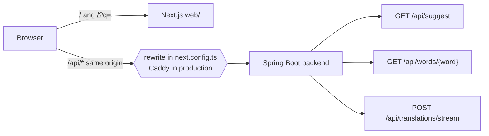
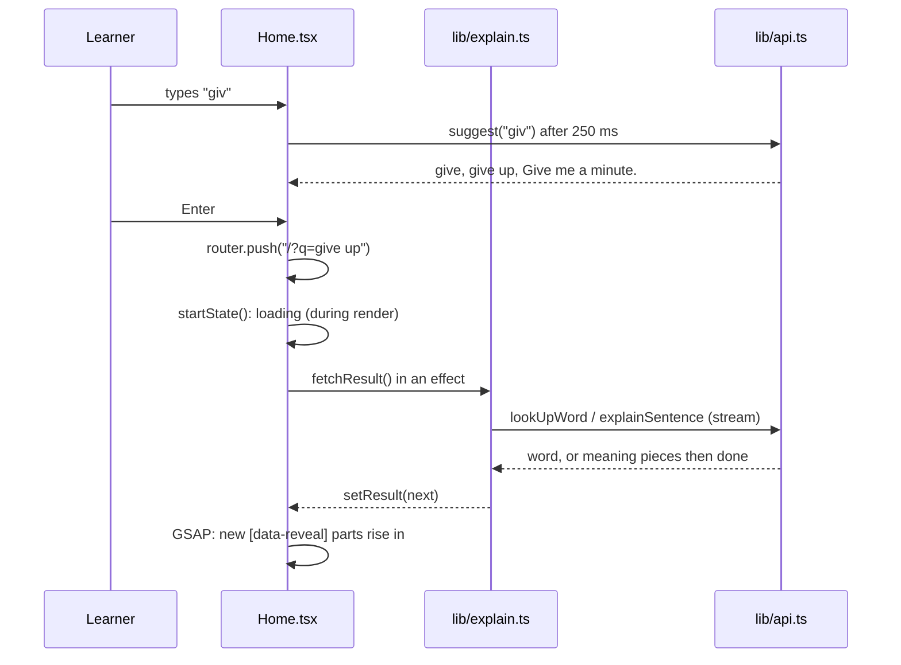
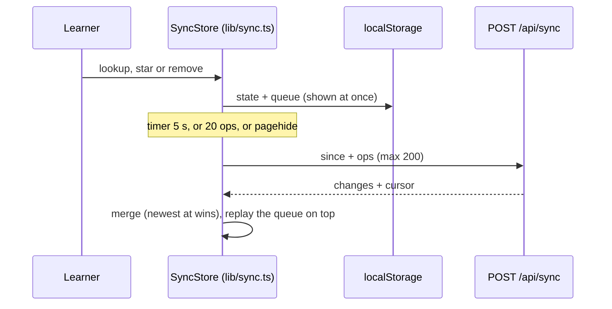
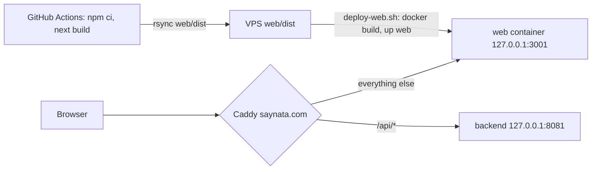
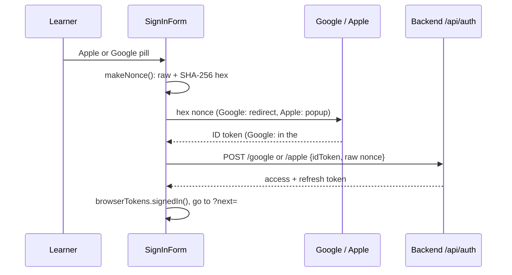

# Web app

> Status: homepage (TASK-102.1) and sign-in (TASK-102) and History and Liked (TASK-102.6) built; the other MVP pages not started (TASK-102). Last traced from code: 2026-10-25 (header option B, Account History section and History glass style, TASK-102.8; before that summary markup, language-line reload, sense badge; before that account page, TASK-102.8; before that History and Liked, TASK-102.6; before that the language row shows the translated headword, TASK-106.8).
> Spec: R1 and R2 in [Vision and spec](../doc-1%20-%20Vision-and-spec.md). Brainstorm and mockups: https://claude.ai/artifact/P4yQXKHykS8zMhFkFKtHyA

## What it does

A website for learners in `web/` (Next.js 16 App Router, Tailwind 4, GSAP). The homepage is the tool itself: type an
English word or sentence, read the simple English explanation, and open your language at the bottom only if you need it.
The text goes into the address (`/?q=give+up`), so a result can be shared, reloaded and reached with Back.
A Mochi cat (the paid sprite pack, served from the server, never from git) sits on the composer card; each visit picks one of Dance, Sleeping, Excited, Sick 1 or Box. Without the sprites, our own pixel cat sleeps there instead, wakes up while you type and hops while Saynata works.

## Big picture

The backend has no CORS setup, so the browser only calls its own origin. In dev, `next.config.ts` rewrites `/api/*` to
`SAYNATA_API_ORIGIN` (default `https://api.saynata.com`), see [next.config.ts:20](../../../web/next.config.ts#L20).

## Step by step

| Step | File | What happens |
|---|---|---|
| Page | [page.tsx](../../../web/src/app/page.tsx) | `SiteHeader` (logo and account menu) and intro; `main` has `pt-4`; `Home` inside `Suspense` because it reads `?q=` |
| State | [Home.tsx:25](../../../web/src/components/home/Home.tsx#L25) | The address is the source of truth. A new query or retry sets the first state during render ([Home.tsx:41](../../../web/src/components/home/Home.tsx#L41)) and an effect fetches the rest ([Home.tsx:58](../../../web/src/components/home/Home.tsx#L58)). **A language change is not a new search:** the result stays on screen. A word's language row loads by itself (WordCard); for a sentence an effect fetches only its language line ([fetchTranslation](../../../web/src/lib/explain.ts#L91)) and `SentenceCard` shows two pulse bars in the language row meanwhile (`translating`) |
| Search | [explain.ts:20](../../../web/src/lib/explain.ts#L20), [explain.ts:35](../../../web/src/lib/explain.ts#L35) | `startState` and `fetchResult`, no React, tested. One word (or a/an/the + word) goes to the word API, the rest to the sentence stream |
| Client | [api.ts:180](../../../web/src/lib/api.ts#L180) | Copied from the extension (`extension/src/shared/api.ts`) plus `suggest()`. Stream first, `POST /api/translations` once as a fallback |
| Suggestions | [Home.tsx:69](../../../web/src/components/home/Home.tsx#L69) | 1-40 characters, 250 ms after the last key, cached and bundled only, so a guest costs nothing |
| Word card | [WordCard.tsx](../../../web/src/components/home/WordCard.tsx) | Headword, IPA, Listen; one card per sense with a teal number badge (`bg-accent`, `text-on-accent`, `size-8`) and level chip and picture or clip; Examples, How to use it and the target language as closed rows, the language last. **Language row (TASK-106.4, doc-5):** every language except English gets it ([useLanguageLines:41](../../../web/src/components/home/WordCard.tsx#L41)); the first time any row opens, one `POST /api/translate-lines` carries all sense explanations ([translateLines:207](../../../web/src/lib/api.ts#L207), [loadLines:74](../../../web/src/lib/lines.ts#L74)). A guest asks with `?cachedOnly=true` (never a Claude call); a signed-in user (`browserTokens`, see Sign in below) gets a missing line from Claude. Lines are kept in memory per (text, language) (`LineCache`). **Headword (TASK-106.8):** the call also sends the word, and an open row shows its translated headword in bold above the line (`LanguageLine`). While it loads Vietnamese shows the dictionary text and other languages a small loading bar; a guest miss shows the dictionary text (Vietnamese) or "Sign in to see this line in your language." with a link to `/sign-in` ([LanguageLine:177](../../../web/src/components/home/WordCard.tsx#L177)); an error shows a short line (Vietnamese keeps the dictionary text). What the row shows is decided by the pure [rowContent:122](../../../web/src/lib/lines.ts#L122) |
| Sentence card | [SentenceCard.tsx](../../../web/src/components/home/SentenceCard.tsx) | Original with tappable words (a tap opens the word sheet; the box, `?q=` and the sentence stay), summary that grows while it streams (`**bold**` and `- ` bullets drawn without their markers by [summaryMarkup.ts](../../../web/src/lib/summaryMarkup.ts), like iOS `SummaryMarkup`; Listen reads the plain text), key words, the target language last and closed, Copy under the card |
| Word sheet | [WordSheet.tsx](../../../web/src/components/home/WordSheet.tsx) | A word tapped in a sentence (or in its Words list) opens the same `WordCard` in a native `<dialog>` with `showModal()`: a bottom sheet on a phone, a centered card from 640 px. It looks the word up with the same `fetchResult` call as a search. Esc, a click on the backdrop and the Close button (aria-label "Close") close it; focus goes back to where it was. Like the iOS `SentenceWordSheet` |
| Language | [targetLanguage.ts](../../../web/src/lib/targetLanguage.ts) | `localStorage` through `useSyncExternalStore`; a change runs the search again |
| Speech | [speech.ts](../../../web/src/lib/speech.ts) | Web Speech API, en-US, rate 0.92 |
| Cat | [MochiCat.tsx](../../../web/src/components/MochiCat.tsx), [mochi.ts:48](../../../web/src/lib/mochi.ts#L48) | One sheet per page visit: Dance (4 frames, 6 fps), Sleep (4, 3), Excited (12, 8), Sick 1 `catsick1` (5, 4) or Box, which picks Box1 (4, 6), Box2 (12, 6) or Box3 (4, 6); the five have equal chance ([pickCat](../../../web/src/lib/mochi.ts#L36)). The pick lives in module memory, so typing, focus, re-renders and tab hide/show keep it; only a reload picks again. Frames are 32 px, shown at 3x (96 px) with `image-rendering: pixelated`; every frame ends on its bottom row, so one box on the card edge fits every sheet, IV stand included. `pointer-events: none`, `aria-hidden`. The sheet is loaded from `/cats/<file>.png`; if it fails, the own `PixelCat` is shown |

### Motion (GSAP)

All motion runs through [withMotion](../../../web/src/lib/motion.ts#L15) (`gsap.matchMedia` with
`prefers-reduced-motion: no-preference`), so reduced motion shows the final state at once.

| Moment | Where | What moves |
|---|---|---|
| Page enters, once | [Home.tsx:89](../../../web/src/components/home/Home.tsx#L89) | `[data-enter]` (intro, composer) rise and fade in, the send button pops in. CSS hides `[data-enter]` only when motion is allowed, and a `<noscript>` rule in `layout.tsx` shows it without JavaScript |
| A result arrives | [Home.tsx:103](../../../web/src/components/home/Home.tsx#L103) | Each new `[data-reveal]` part rises 12 px, 0.42 s, 0.06 s apart. Parts already shown are marked `data-shown`, so the stream finishing does not replay the card |
| Suggestions change | [Home.tsx:119](../../../web/src/components/home/Home.tsx#L119) | Chips fan out, 0.25 s, 0.03 s apart |
| The cat appears | [MochiCat.tsx:53](../../../web/src/components/MochiCat.tsx#L53) | Drops onto the card with `bounce.out` once its picture is ready (GSAP) |
| The Mochi loop | [globals.css:111](../../../web/src/app/globals.css#L111) | CSS `steps(frames)` on `background-position`, no JavaScript timer. Paused while the tab is hidden (`data-tab-hidden` on `<html>`), frame 1 only with reduced motion |
| The fallback cat | [PixelCat.tsx:68](../../../web/src/components/PixelCat.tsx#L68) | Asleep: slow breathing and three z letters; awake: faster breathing, open eyes; busy: small hops |
| The word sheet opens | [WordSheet.tsx](../../../web/src/components/home/WordSheet.tsx) | The panel rises 28 px and fades in, 0.32 s |

Folded rows open with a CSS grid-rows transition, not GSAP and not `height`, and a closed row is `inert`.

Focus: the global `:focus-visible` outline sits in `@layer base` (`globals.css`), so a Tailwind utility can turn it off. The composer textarea uses `outline-none`, and its card shows focus instead (`focus-within`: accent border and a soft ring).

## History and Liked (TASK-102.6, doc-22)

A signed-in user has History and Liked on `/history`, the same lists as the phone and the Mac. A guest sees a sign-in prompt there, and no star on results.

| Step | File | What happens |
|---|---|---|
| Store | [sync.ts:150](../../../web/src/lib/sync.ts#L150) | `SyncStore`: local copy plus op queue per account (`saynata.sync.<email>`). No React, tested with a fake transport |
| Merge | [applyOp:100](../../../web/src/lib/sync.ts#L100), [mergeItems:124](../../../web/src/lib/sync.ts#L124) | Newest `at` wins; removes and "clear all" stay as tombstones; the server wins a tie; the queue is replayed over every pull |
| Flush | [sync.ts:238](../../../web/src/lib/sync.ts#L238) | 5 s after the last change, at 20 ops, and `pagehide` with `keepalive` (the queue stays, a repeat is harmless). A failure retries after 30 s; a 400 drops the batch |
| Transport | [browserTransport:382](../../../web/src/lib/sync.ts#L382) | Bearer token, one refresh and retry on 401 |
| Record | [Home.tsx:57](../../../web/src/components/home/Home.tsx#L57) | A finished word or sentence result is a `history_add` (preview = first simple explanation, chip = "pos · level") |
| Star | [LikeButton.tsx](../../../web/src/components/home/LikeButton.tsx) | On word and sentence results; `liked_add` / `liked_remove` |
| Page | [HistoryView.tsx](../../../web/src/components/history/HistoryView.tsx), [HistoryRows.tsx](../../../web/src/components/history/HistoryRows.tsx) | History \| Liked pill, search, clear all (asks first), day groups, "synced N s ago". **Glass style (TASK-102.8):** the pill, the search box and each day's list use `GLASS` (`border-hairline bg-surface/70 backdrop-blur-xl`, rounded corners, soft shadow); the selected pill segment is `bg-surface/90`; day titles are small bold muted text. Tokens only, so it works in light and dark. A row ([HistoryRow](../../../web/src/components/history/HistoryRows.tsx)) follows iOS `SavedItemRow`: a word is bold with its chip, a sentence is serif and stops at two lines, then the short meaning in two lines at most; star and remove are icon buttons |

## Deploy (saynata.com, TASK-102.2, moved from loffy.me in TASK-104)

`next.config.ts` sets `output: "standalone"` ([next.config.ts:11](../../../web/next.config.ts#L11)), so the build writes a small
Node server. The job `deploy-web` in [deploy.yml](../../../.github/workflows/deploy.yml) builds it on GitHub (not on the VPS: `next build`
can run out of memory there), copies server, static files and `public` to `web/dist` on the server, and runs
[deploy-web.sh](../../../web/scripts/deploy-web.sh). That builds [web/Dockerfile](../../../web/Dockerfile) (`node:22-alpine`, only a copy) and
restarts the `web` service of [docker-compose.prod.yml](../../../backend/docker-compose.prod.yml). `cacheComponents` and the prerendered
homepage work in this mode (checked with `node server.js` locally). Caddy lines, DNS and the by-hand steps: doc-11 section 14.
In production Caddy sends `/api/*` to the backend, so the rewrite in `next.config.ts` is not used.

## Sign in (TASK-102)

Two pages, [/sign-in](../../../web/src/app/sign-in/page.tsx) ("Log in") and [/sign-up](../../../web/src/app/sign-up/page.tsx), show the same
form in two modes. Sign-in and sign-up are one flow on the backend: verifying a code for a new email makes the account. On a wide screen
the cat room ([CatRoom.tsx](../../../web/src/components/CatRoom.tsx)) sits left of the form; under 760 px only the form shows.
The room is the cozy or playful picture of the paid pack (precomposed 512 px PNGs from RandomCatRoom, 50/50 per visit, served from `/cats/`, uploaded by `scripts/upload-web-cats.sh`);
without it a plain panel with `PixelCat` shows.

| Part | File | What it does |
|---|---|---|
| Form | [SignInForm.tsx:53](../../../web/src/components/auth/SignInForm.tsx#L53) | Apple and Google pills first, then under "or" the email field ("Email me a code"), then the 6-digit code ([sendCode:146](../../../web/src/components/auth/SignInForm.tsx#L146), [verify:165](../../../web/src/components/auth/SignInForm.tsx#L165)). No emailed link: it opens `saynata://`, so it is app-only |
| Google | [google:99](../../../web/src/components/auth/SignInForm.tsx#L99) | Redirect to Google with `response_type=id_token`; the state and raw nonce wait in sessionStorage (`saynata.google-sign-in`); back on `/sign-in` the ID token is read from the address hash |
| Apple | [apple:121](../../../web/src/components/auth/SignInForm.tsx#L121) | AppleID JS in a popup with the Services ID |
| Client | [auth.ts:52](../../../web/src/lib/auth.ts#L52) | `AuthApi`: email-code, verify, google, apple, refresh, sign-out. Auth errors (`invalid_code` etc.) show the server's text |
| Session | [auth.ts:121](../../../web/src/lib/auth.ts#L121) | `BrowserTokens`: the session in localStorage (`saynata.session`), refreshed 60 s before it expires, one shared refresh; a 401 on refresh signs out, a network error keeps the session. It is the `TokenSource` of every `SaynataApi` |
| Header (option B, TASK-102.8) | [SiteHeader.tsx](../../../web/src/components/SiteHeader.tsx), [AccountMenu.tsx](../../../web/src/components/auth/AccountMenu.tsx) | Logo home. A guest sees only the "Sign in" pill. A signed-in user sees a History icon button (`/history`) and an avatar circle (`bg-accent`, `text-on-accent`, the first letter of the email, [avatarLetter](../../../web/src/lib/account.ts)). The avatar button (aria-label "Account menu", `aria-expanded`) opens a menu: the email (small, muted) on top, then Settings, Account and Sign out. The email is never in the header itself. The menu closes on Escape (focus returns to the avatar), on a click outside and on Tab; ArrowUp/Down, Home and End move between the items; the first item gets focus when it opens |
| Account page (TASK-102.8) | [AccountPage.tsx](../../../web/src/components/auth/AccountPage.tsx), [account.ts](../../../web/src/lib/account.ts) | `/account`: profile card (pixel cat, email, "Member since October 2026 · Google" from `GET /api/me`, Sign out icon), three stat tiles (Words looked up, Liked, AI answers today as "7 / 50"), a **History section** (the 5 most recent items from the same sync store as `/history`, in the same glass rows, with a "See all" link to `/history`; a short empty state when there are none) and a Delete account row. A guest is sent to `/sign-in?next=/account`. Delete is two taps: the red trash icon, then it turns into a confirm state (with Cancel); confirm calls `DELETE /api/me`, `browserTokens.signOut()`, then goes home. `AccountApi` sends the Bearer token and retries once after a refresh |
| After sign-in | [safeNextPath:257](../../../web/src/lib/auth.ts#L257) | Goes to `?next=` only when it is a path on this site, else `/` |

Client IDs: `NEXT_PUBLIC_GOOGLE_CLIENT_ID` (default: the web OAuth client) and `NEXT_PUBLIC_APPLE_SERVICES_ID` (default `com.saynata.web`),
[auth.ts:266](../../../web/src/lib/auth.ts#L266). The backend must list both in `GOOGLE_CLIENT_IDS` and `APPLE_CLIENT_IDS` (doc-11 section 13, doc-17).

## Settings (TASK-102.7)

`/settings` ([page.tsx](../../../web/src/app/settings/page.tsx), [SettingsForm.tsx](../../../web/src/components/settings/SettingsForm.tsx)) has two cards: **Translation** (Language select from `languages.ts`; Show translation as a pill: Collapsed, Always open, Remember) and **History** (Sync history switch: "Keep your history the same on phone, Mac and web."). Defaults: Remember, sync on.

| Step | File | What happens |
|---|---|---|
| Store | [settings.ts:92](../../../web/src/lib/settings.ts#L92) | `SettingsStore`: the snapshot is in localStorage (`saynata.settings`; the language keeps `saynata.targetLang`, so the homepage reads it as before). `update(patch)` applies at once and, when signed in, sends `PUT /api/me/settings` in the background; a failed send keeps the local value |
| Load | [settings.ts:118](../../../web/src/lib/settings.ts#L118) | `load()` reads `GET /api/me/settings` when signed in (page open, `Home`); a guest or a failed request keeps the local settings. One retry after a 401 |
| Guest | settings.ts | A guest's settings never leave the browser |
| Show translation | [translationRowOpen](../../../web/src/lib/settings.ts#L190) | Word and sentence cards start the language row open (Always open), closed (Collapsed) or as the user left the last one (Remember, `saynata.translationOpen`). Values are the backend's: `collapsed`, `alwaysOpen`, `remember` |

## Errors

| Cause | Where | HTTP | What the user sees |
|---|---|---|---|
| Guest asks for something not cached | `errorMessage` in [explain.ts:79](../../../web/src/lib/explain.ts#L79) | 401 `sign_in_required` | "Sign in to explain new text. Dictionary words and common sentences work without an account." with a link to `/sign-in?next=` |
| Word not on the word list | same | 404 | "This word is not in the dictionary yet. Check the spelling." |
| Too many requests | `rateLimitMessage` in api.ts | 429 | "Too many requests. Try again in N minutes." |
| No connection | api.ts | — | "Can't reach Saynata. Check your connection and try again." |
| Wrong code, bad email, provider not set up | `authError` in [auth.ts:40](../../../web/src/lib/auth.ts#L40) | 400 / 401 | The server's own text, for example "That code is wrong or expired." |
| Google or Apple did not finish | SignInForm | — | "Google sign-in did not finish. Try again." (or Apple) |
| Over 500 characters | `startState` | — | "Make it shorter: up to 500 characters." and the counter turns red |

## Tests

`cd web && npm test` (Vitest) and `npm run build`. CI runs both (job `web`). The deploy has no unit test; its check is `curl -f https://saynata.com` at the end of `deploy-web`.

| Test file | What it covers |
|---|---|
| `web/test/api.test.ts` | The client (from the extension) and `suggest()` |
| `web/test/sse.test.ts` | The stream parser |
| `web/test/textKind.test.ts` | Word or sentence |
| `web/test/mochi.test.ts` | The five choices have equal shares, Box picks one of three, the visit keeps its cat, a missing file means fallback, `steps()` and frame 1 with reduced motion in `globals.css` |
| `web/test/auth.test.ts` | Auth calls and errors, the stored session, refresh before expiry, one shared refresh, sign-out on 401, `makeNonce`, `safeNextPath`, `isValidEmail` |
| `web/test/account.test.ts` | `AccountApi` (Bearer, DELETE, one refresh, no token, errors), `memberLine`, `statTiles`, `avatarLetter`, the guest redirect path |
| `web/test/settings.test.ts` | Account load and save (Bearer, PUT body, one retry after 401, unknown values), a guest keeps localStorage and sends nothing, a signed-in change applies at once, a failed load keeps the local settings, `translationRowOpen` |
| `web/test/summaryMarkup.test.ts` | Bullets, bold, an unclosed `**` while streaming, `plainSummary` |
| `web/test/explain.test.ts` | `startState`, word result, meaning growing piece by piece, sign-in message, nothing after a cancel |

## Change checklist

- The Mochi PNGs never go in git or in `web/public` (no right to redistribute, the repo is public). `scripts/upload-web-cats.sh` copies them to the server; the file names in it and in `CAT_SHEETS` (`lib/mochi.ts`) must match. The sign-in room pictures follow the same rule (same script, names in `CatRoom.tsx`).
- `lib/api.ts`, `lib/sse.ts`, `lib/textKind.ts`, `lib/languages.ts`, `lib/lines.ts` are copies of `extension/src/shared/`. A fix in one belongs in the other.
- Colors are tokens in `globals.css`, the same values as the iOS Color Sets. Change the Color Set first (design-system.md).
- A new element that should enter with the page gets `data-enter`; a new part of a result gets `data-reveal`.

## Known gaps

- Only the homepage and sign-in exist. Word page (`/word/run`), Introduction, History & Liked, Privacy & Terms and 404 are TASK-102.
- A guest's miss ends with a message and a link to `/sign-in`, not a sign-in sheet. No Like star and no History yet.
- A guest sees a language line only when the backend already has it (TASK-106.5 fills them all); signed in, a missing line comes from Claude.
- The `deploy-web` check fails until the developer adds the DNS record and the Caddy block once (doc-11 section 14); the repo does not manage the Caddyfile.
- The Mochi sprites are only on the server (`/var/lib/saynata/web-cats`, uploaded by hand). Local dev shows the fallback cat (and the plain sign-in panel) unless you copy them into `web/public/cats/` (git-ignored).
