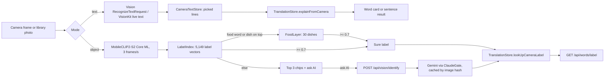
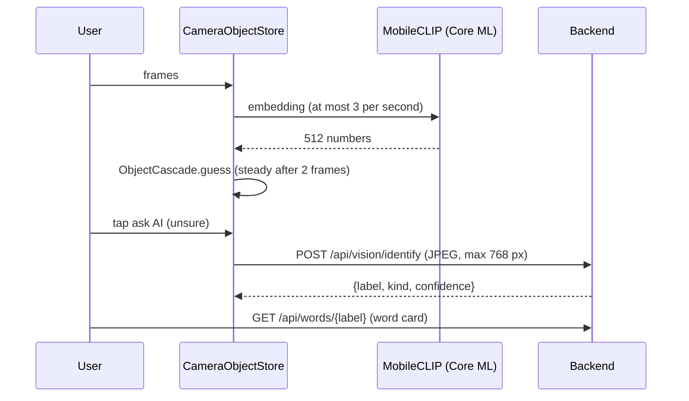

# Camera explain

> Status: F8 (TASK-121). Built end to end (mockup approved 2026-11-02); not yet run on a device. Last traced from code: 2026-11-02.
> Spec: product rule "explain first, translate last" in [CLAUDE.md](../../../CLAUDE.md); measurements in [scripts/vision_spike/README.md](../../../scripts/vision_spike/README.md) (TASK-120).

## What it does

A camera button on the home screen opens the camera. **Text mode** reads English text (live, or from a library photo); the user taps lines, or all text, and gets the normal result (a word card for one word, else the sentence result). **Object mode** names the thing in front of the camera (a desk, a bowl of phở) and a tap opens its word card. When the phone is unsure it shows three label chips and an icon-only "ask AI" button that sends one small photo to the backend.

## Big picture

## Step by step

### iOS

| Step | File:line | What happens |
|---|---|---|
| Camera button | [TranslateInputView.swift:38](../../../EnglishTranslation/EnglishTranslation/Views/Translate/Subviews/TranslateInputView.swift#L38) | icon-only `camera` button left of Explain; [TranslateView.swift:60](../../../EnglishTranslation/EnglishTranslation/Views/Translate/TranslateView.swift#L60) opens `CameraScreen` as a full-screen cover |
| Screen | [CameraScreen.swift:33](../../../EnglishTranslation/EnglishTranslation/Views/Camera/CameraScreen.swift#L33) | asks for the camera once, mode switch ([:162](../../../EnglishTranslation/EnglishTranslation/Views/Camera/CameraScreen.swift#L162)), photo picker ([:231](../../../EnglishTranslation/EnglishTranslation/Views/Camera/CameraScreen.swift#L231)); the feed runs only in object mode with no photo while the app is active ([:223](../../../EnglishTranslation/EnglishTranslation/Views/Camera/CameraScreen.swift#L223)); a result closes the screen and hands off ([:216](../../../EnglishTranslation/EnglishTranslation/Views/Camera/CameraScreen.swift#L216)) |
| Live text | [LiveTextScanner.swift:70](../../../EnglishTranslation/EnglishTranslation/Views/Camera/LiveTextScanner.swift#L70) | VisionKit `DataScannerViewController` (en-US, highlighting on); lines numbered and made 0...1 like Vision's boxes; a tap picks a line ([:64](../../../EnglishTranslation/EnglishTranslation/Views/Camera/LiveTextScanner.swift#L64)) |
| Camera frames | [CameraFeed.swift:74](../../../EnglishTranslation/EnglishTranslation/Camera/CameraFeed.swift#L74) | `AVCaptureSession` 1280×720, at most 4 frames a second turned into `CGImage` off the main thread |
| Bottom card | [CameraPanels.swift:34](../../../EnglishTranslation/EnglishTranslation/Views/Camera/CameraPanels.swift#L34), [:74](../../../EnglishTranslation/EnglishTranslation/Views/Camera/CameraPanels.swift#L74) | text: picked text, "Use all text", Explain; objects: sure row, 3 chips and "Ask AI what this is" |
| Image vector | [ImageEmbedding.swift:35](../../../EnglishTranslation/EnglishTranslation/Camera/ImageEmbedding.swift#L35) | `MobileCLIPEmbedder` loads `MobileCLIPImage.mlmodelc` once (compute units `.all`), center-crops to 256×256, returns the length-1 vector |
| Label scores | [VisionLabels.swift:73](../../../EnglishTranslation/EnglishTranslation/Camera/VisionLabels.swift#L73) | `LabelIndex.top`: cosine with every label vector (vDSP), softmax at temperature 100 (the spike's scale) |
| Dish score | [VisionLabels.swift:117](../../../EnglishTranslation/EnglishTranslation/Camera/VisionLabels.swift#L117) | `FoodLayer.best`: softmax(weights · vector + bias) over 30 dishes |
| Cascade | [ObjectCascade.swift:29](../../../EnglishTranslation/EnglishTranslation/Camera/ObjectCascade.swift#L29) | food word or dish on top and the layer ≥ 0.7 → the dish; else zero-shot ≥ 0.7 → that word; else top 3 chips |
| Throttle and steadiness | [CameraObjectStore.swift:66](../../../EnglishTranslation/EnglishTranslation/Camera/CameraObjectStore.swift#L66) | drops frames while busy or within 1/3 s; a new label must win 2 analyses in a row; missing model files → `isUnavailable` |
| Ask AI | [CameraObjectStore.swift:100](../../../EnglishTranslation/EnglishTranslation/Camera/CameraObjectStore.swift#L100) | newest frame → `SmallJPEG` (long side ≤ 768 px, quality 0.7) → `identify`; errors become `message` (sign-in, limits) |
| Upload | [VisionIdentifying.swift:31](../../../EnglishTranslation/EnglishTranslation/Camera/VisionIdentifying.swift#L31) | multipart field `image`, Bearer token through `sendChecked` |
| Photo text | [CameraText.swift:29](../../../EnglishTranslation/EnglishTranslation/Camera/CameraText.swift#L29) | `VisionTextReader`: accurate, `en-US`, language correction; lines in reading order |
| Joining | [CameraText.swift:57](../../../EnglishTranslation/EnglishTranslation/Camera/CameraText.swift#L57) | cut words joined ("exam-" + "ple"), spaces collapsed, cut at 500 characters at a sentence end |
| Text hand-off | [TranslationStore.swift:248](../../../EnglishTranslation/EnglishTranslation/Stores/TranslationStore.swift#L248) | `explainFromCamera`: text from elsewhere (no "better version" offer), normal `translate()` |
| Label hand-off | [TranslationStore.swift:255](../../../EnglishTranslation/EnglishTranslation/Stores/TranslationStore.swift#L255) | `lookUpCameraLabel`: always the word path, so "bánh mì" is not sent down the phrase or sentence path |

### Backend

| Step | File:line | What happens |
|---|---|---|
| Endpoint | [VisionController.java:22](../../../backend/src/main/java/com/englishtranslation/backend/vision/VisionController.java#L22) | `POST /api/vision/identify`, multipart `image` |
| Identify | [VisionService.java:74](../../../backend/src/main/java/com/englishtranslation/backend/vision/VisionService.java#L74) | size and magic-byte check, SHA-256 cache in `vision_identify` (V40, with `app.claude.vision-prompt-version`), else `ClaudeGate` (`Feature.VISION`) and Gemini; the photo is never stored |
| Gemini call | [GeminiClient.java:73](../../../backend/src/main/java/com/englishtranslation/backend/claude/GeminiClient.java#L73) | `describeImage`: OpenAI-compatible endpoint, image as a base64 data URI |
| Answerable labels | [VisionLabels.java:62](../../../backend/src/main/java/com/englishtranslation/backend/vision/VisionLabels.java#L62) | the 30 dishes (`words/dishes.txt`, "pho" maps to "phở") and labels in `vision_identify` |
| Word gate | [WordService.java:118](../../../backend/src/main/java/com/englishtranslation/backend/word/WordService.java#L118) | such a label is treated like a sentence wordMatch (TASK-114.5): the LLM may describe it for a signed-in user |

### Model files

`scripts/vision_spike/build_coreml.py` writes `EnglishTranslation/EnglishTranslation/Resources/Vision/` (in git, 42 MB): `MobileCLIPImage.mlpackage` (8-bit weights, 36 MB), `label_vectors.f16` (5,149 × 512 float16), `labels.json` (labels, food and dish flags, temperature), `food_layer.json`. `Camera`, `Views/Camera` and `Resources/Vision` are excluded from the Share extension, the Translation extension and the Mac app in `project.pbxproj`.

## Errors

| Cause | Where | HTTP | What the user sees |
|---|---|---|---|
| Guest sends a new photo | `ClaudeGate` | 401 `sign_in_required` | "Sign in to get a new explanation." under the chips |
| Too many requests | `ClaudeGate` | 429 `rate_limited` | the rate-limit message |
| Daily budget used | `ClaudeGate` | 503 `daily_limit_reached` | the server's message |
| Photo over 2 MB / not JPEG or PNG | `VisionService` | 413 `file_too_large` / 400 `invalid_image` | message under the chips (the app sends ≤ 768 px, so this should not happen) |
| Gemini failed or no key | `VisionService` | 502 `vision_failed` / 503 `vision_unavailable` | message under the chips |
| Model files missing or broken | `CameraObjectStore` | none | object mode unavailable, text mode still works |
| No text in a photo | `CameraTextStore` | none | "No English text found in this photo." |

## Tests

| Test file | What it covers |
|---|---|
| `EnglishTranslationTests/CameraObjectTests.swift` | label scores, food layer, cascade branches, throttle, steadiness, missing model, ask AI (success, sign-in, no frame, reset), 768 px JPEG, multipart body |
| `EnglishTranslationTests/CameraTextTests.swift` | reading order, joining lines, picking lines, all text, no-text message, live lines, label and text hand-off to `TranslationStore` |
| `backend/.../vision/VisionIdentifyApiTest.java` | endpoint: guest, size, type, cache hit (one Gemini call), response shape |
| `backend/.../vision/VisionWordLabelsTest.java` | dishes and vision labels answerable by `GET /api/words`, "pho" → "phở", unknown label still not a word |

Run: `xcodebuild test -project EnglishTranslation/EnglishTranslation.xcodeproj -scheme EnglishTranslation -destination 'platform=iOS Simulator,name=iPhone 16 Pro,OS=18.5' -only-testing:EnglishTranslationTests/CameraObjectStoreTests -only-testing:EnglishTranslationTests/ObjectCascadeTests -only-testing:EnglishTranslationTests/CameraTextStoreTests` and `cd backend && ./mvnw -B test -Dtest='Vision*'`.

## Change checklist

- New labels or a new model: run `build_coreml.py` again and commit all four files together (the vectors must match the encoder).
- Changing the temperature or a threshold: measure again with `clip_test.py` / `food_probe.py` and update the README.
- Changing the vision prompt: bump `app.claude.vision-prompt-version` (old labels stop being answerable until identified again).
- A new dish: `backend/src/main/resources/words/dishes.txt`, `DISHES` in `build_coreml.py`, and retrain the food layer.

## Known gaps

- Not compiled or run in CI (there is no iOS job): build and test on the Mac before merging.
- Live text needs a phone that supports VisionKit's DataScanner; the simulator has no camera, so only library photos work there.
- The 8-bit model was checked against PyTorch with the same rounding on Linux, not run on a device yet.
- The food layer is trained on 30VNFoods (CC BY-NC-SA): retrain before the App Store (TASK-122). How often it calls a non-food photo a dish is not measured.
- `gemini-3.5-flash-lite` has no price entry in `app.claude.pricing`; vision usage is counted at the highest listed price.
